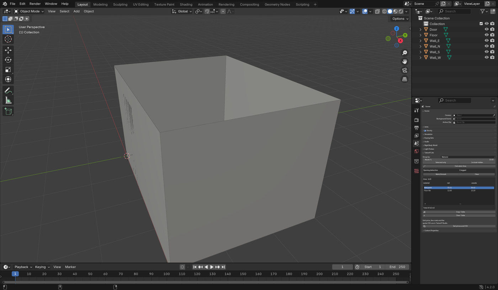

# Takeoff Lite

Surface area per material from the Blender model you already have — with door
and window openings deducted, and a waste allowance. **Free.**

This is the free half of [Takeoff Studio](https://tnnt.gumroad.com/l/takeoff-studio).
It answers one question honestly: how much of each material do I have to buy?



*The panel, on a 4 x 3 m room with one door and one window. Wall paint 33.11 m²
after the door and window are taken out; floor tile 12.00 m²; 49.62 m² including
10 percent waste.*

## What it does

- **Area per material** — every polygon, world space, honouring object scale.
  A 4 m wall and a 40 cm plinth land in the same table.
- **Opening deduction** — tag a door or window mesh once; its faces are carved
  out of whatever they sit in. This is done by exact polygon clipping in the
  shared plane, not by guessing or sampling. A door in a wall really is
  subtracted; a door standing next to a wall is not.
- **Waste allowance** — one percentage, applied per line.
- **Total** — net area and area including waste, in the scene's own unit.
- **Copy Table** — puts the table on the clipboard as tab separated text, so it
  pastes straight into Excel, Numbers or Sheets.

## What it does not do

Unit prices, line costs and the quote CSV live in the paid version,
[Takeoff Studio](https://tnnt.gumroad.com/l/takeoff-studio).

## Install

1. Download `takeoff_lite-0.1.0.zip` from the
   [latest release](https://github.com/yunqingtao/takeoff-lite/releases/latest).
   Do **not** unzip it.
2. Blender → Edit → Preferences → Add-ons → ⌄ (top right) → *Install from Disk…*
3. Pick the zip, tick the checkbox next to **Takeoff Lite**.
4. In the 3D viewport press `N` and look for the **Takeoff** tab.

Works on Blender 4.2 LTS and newer. No dependencies, no network calls.

## How to measure a room

1. Model (or open) the room. Each surface must be a mesh; materials do the
   grouping, so give the walls a `Plaster` material and the floor a `Tile` one.
2. Open the **Takeoff** tab, press **Calculate Area**.
3. Door and window meshes would otherwise be counted as another surface. Select
   the door mesh, press **Mark/Unmark** under *Opening deduction*, then press
   **Calculate Area** again — its faces are subtracted from the wall behind it.
4. Set `Waste %` to whatever you actually lose on site (10% is a safe start) and
   calculate once more.
5. **Copy Table**, paste into your spreadsheet.

## Units

The result follows the scene unit setting. A scene in metres gives m², a scene
in feet gives ft². Nothing is converted behind your back.

## Verified numbers

The test suite ([tests_lite.py](tests_lite.py)) builds a 4 m × 3 m room with
2.5 m walls and asserts the arithmetic against hand calculations:

| Case | Expected |
| --- | --- |
| Walls, 4 m × 3 m × 2.5 m, `Plaster` | 35.00 m² |
| Floor, 4 m × 3 m, `Tile` | 12.00 m² |
| Total with 10 % waste | 51.70 m² |
| Same room, 0.90 m × 2.10 m door tagged as an opening | `Plaster` 33.11 m² |
| Plus a 1.00 m × 1.00 m window in another wall | `Plaster` 32.11 m² |
| 10 ft × 10 ft surface in an imperial scene | 100.00 sq ft |

Run them yourself:

```bash
blender -b --factory-startup --python tests_lite.py
```

There is a second gate, `install_test_lite.py`, which unzips the built release
into a clean user scripts directory, enables the add-on the way a stranger
would, and measures the same room from the installed copy.

## Build

```bash
python package.py          # writes dist/takeoff_lite-<version>.zip
```

## Licence

GPL-3.0-or-later, the same licence Blender itself uses.
